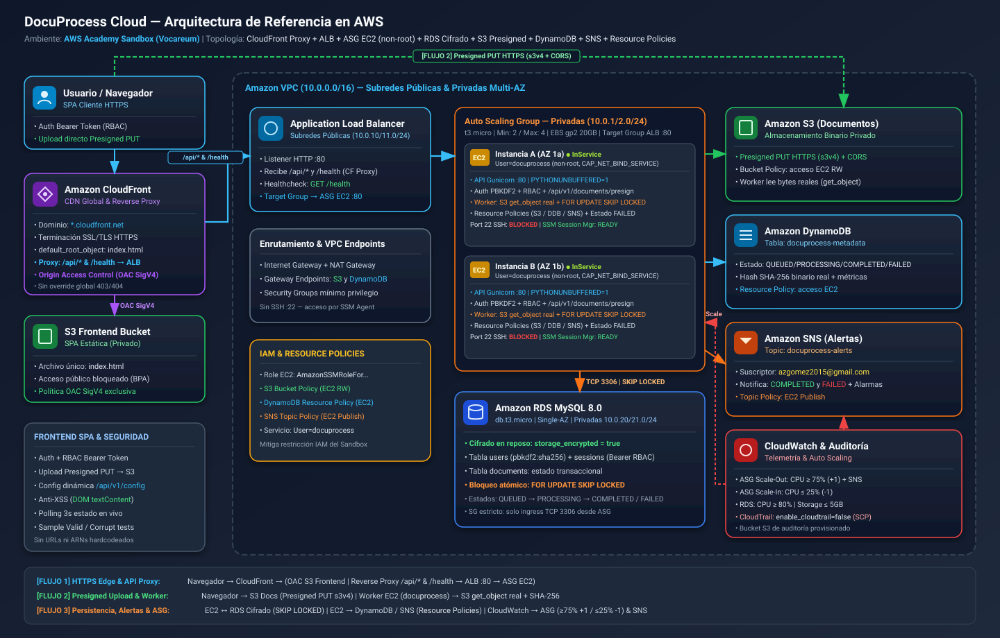
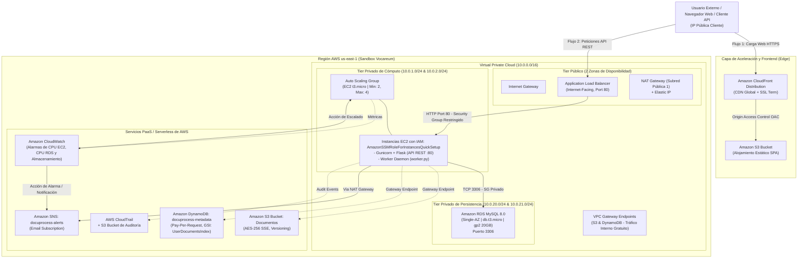

# DocuProcess Cloud — Plataforma SaaS de Procesamiento Asíncrono de Documentos

Infraestructura como Código (IaC) en Amazon Web Services (AWS) mediante HashiCorp Terraform v1.5+, optimizada y estrictamente adaptada para operar sin bloqueos sobre el entorno de laboratorio **AWS Academy Learner Lab / Sandbox (Vocareum)**.

---

## 1. Descripción General del Caso de Estudio

**DocuProcess Cloud** es una plataforma SaaS (*Software as a Service*) orientada al segmento empresarial (*B2B/Enterprise*), diseñada para la ingesta, almacenamiento, extracción de metadatos (OCR, conteo de páginas, hash criptográfico) y análisis asíncrono de documentos e imágenes de gran volumen.

### Requerimientos Funcionales y de Negocio
- **Portal Web de Usuario (Frontend Estático):** Aplicación de una sola página (*SPA - Single Page Application*) para registro, autenticación, subida de documentos y visualización en tiempo real del historial de procesamiento.
- **API REST de Gestión (Backend Compute):** Servicio web transaccional para autenticación, gestión de sesiones de usuario y endpoints para la ingesta y consulta de estado.
- **Módulo Worker de Procesamiento Asíncrono:** Proceso desacoplado en segundo plano (*Background Daemon*) que inspecciona las colas de trabajo, analiza los archivos persistidos en S3, extrae métricas y actualiza el almacén NoSQL.
- **Módulo de Notificaciones y Alertas:** Notificación automática hacia los clientes y administradores mediante Amazon SNS (correo electrónico) tras la finalización exitosa o falla en la ingesta.

---

## 2. Diagrama de Arquitectura de Referencia

La arquitectura implementa separación de preocupaciones (*Clean Architecture*) y aislamiento estricto de capas de red en el modelo OSI (Capas 2, 3, 4 y 7).

<p align="center">
  
</p>

<details>
<summary><b>Ver Definición en Código de Arquitectura (Mermaid.js)</b></summary>


</details>

---

## 3. Justificación Técnica: Base de Datos Relacional (RDS) vs. NoSQL (DynamoDB)

La arquitectura de DocuProcess Cloud emplea un enfoque políglota de persistencia (*Polyglot Persistence*), asignando cada modelo de datos al motor cuyas garantías matemáticas y de concurrencia satisfacen de forma óptima los requisitos del negocio:

| Dimensión Técnica | Amazon RDS (MySQL 8.0) | Amazon DynamoDB (NoSQL) |
| :--- | :--- | :--- |
| **Dominio y Caso de Uso** | **Cuentas de Usuario, Autenticación y Billing** | **Metadatos de Documentos, Historial y Logs de OCR** |
| **Modelo de Consistencia** | **ACID Estricto** (Atomicidad, Consistencia, Aislamiento serializable, Durabilidad). | **Eventual / Fuertemente Consistente** seleccionable por operación. |
| **Estructura del Esquema** | **Esquema Rígido y Normalizado (3FN):** Claves foráneas, tablas de roles, credenciales e integridad referencial. | **Sin Esquema (Schema-less / Flexible):** Metadatos variables por tipo de archivo (PDF, PNG, TIFF) con atributos heterogéneos. |
| **Complejidad de Consulta** | **Uniones Relacionales (SQL JOINs):** Comprobación de membresía, relaciones usuario-organización y transacciones financieras. | **Búsqueda por Clave Primaria (Key-Value):** Lecturas ultra-rápidas mediante `document_id` y consultas cronológicas indexadas. |
| **Complejidad Computacional** | Búsquedas indexadas por B-Tree con complejidad de tiempo: $$\mathcal{O}(\log N)$$ | Búsqueda por tabla Hash en la partición: $$\mathcal{O}(1)$$ |
| **Escalabilidad y Capacidad** | Escalado vertical de cómputo (con clase `db.t3.micro` en Sandbox); Single-AZ por directiva. | **Escalabilidad Horizontal Infinita:** Modelo `PAY_PER_REQUEST` (On-Demand) que absorbe ráfagas sin provisionar capacidad. |
| **Razón de Selección en DocuProcess** | Garantiza que no existan inconsistencias ni duplicidad en el registro de usuarios o asignación de privilegios. | Permite almacenar millones de registros de procesamiento con atributos dinámicos (OCR text, dimensiones, hash SHA-256) sin migraciones DDL. |

---

## 4. Requisitos Previos y Gestión de Credenciales

En entornos educativos como **AWS Academy Learner Lab (Vocareum)**, las credenciales temporales rotan cada vez que se inicia una sesión de laboratorio. **Bajo el principio de Zero Hardcoding, nunca deben guardarse credenciales, tokens ni contraseñas en archivos del repositorio.**

### Configuración Dinámica de Credenciales (AWS CLI)
Al iniciar una nueva sesión en Vocareum (`Start Lab`), copie las credenciales temporales del panel `AWS Details -> AWS CLI` y aplíquelas en su entorno mediante cualquiera de estas dos opciones estándar:

**Opción A: Vía AWS CLI (Recomendado):**
```bash
aws configure set aws_access_key_id "ASIA..."
aws configure set aws_secret_access_key "..."
aws configure set aws_session_token "IQoJb3JpZ..."
aws configure set region "us-east-1"
```

**Opción B: Vía Variables de Entorno de Sesión:**
```bash
export AWS_ACCESS_KEY_ID="ASIA..."
export AWS_SECRET_ACCESS_KEY="..."
export AWS_SESSION_TOKEN="IQoJb3JpZ..."
export AWS_DEFAULT_REGION="us-east-1"
```

**Verificación de Conectividad con el Laboratorio:**
```bash
aws sts get-caller-identity
```

---

## 5. Estructura Modular del Proyecto (Clean Architecture IaC)

La infraestructura como código está organizada modularmente siguiendo el principio de **Separación de Responsabilidades (Separation of Concerns)**, desacoplando cada dominio técnico en archivos temáticos sin introducir la sobrecarga ni el riesgo de reasignación de estados de los submódulos:

```
DocuProcess-Cloud-SaaS/
├── providers.tf         # Declaración de providers AWS y Random, data sources (AZs, AMI AL2023)
├── variables.tf         # Variables de entrada tipadas (región, CIDRs, credenciales, CloudTrail flag)
├── locals.tf            # Nombres comunes, ARN de rol SSM EC2 y generación criptográfica de clave RDS
├── network.tf           # VPC 10.0.0.0/16, 6 subredes, IGW, NAT GW, EIP, Tablas de Enrutamiento y VPC Endpoints
├── storage_cdn.tf       # Buckets S3, CORS, Bucket Policies, OAC y CloudFront (Reverse Proxy /api/* y /health)
├── database.tf          # Amazon RDS MySQL 8.0 (Single-AZ cifrado) y Amazon DynamoDB + Resource Policy
├── compute.tf           # Security Groups, ALB, Target Group, Launch Template (usuario non-root) y ASG
├── monitoring.tf        # Topic SNS + Resource Policy, suscripción email, alarmas CloudWatch y CloudTrail opcional
├── outputs.tf           # Endpoints públicos (ALB DNS, CloudFront CDN, RDS MySQL, S3, SNS ARN)
├── scripts/
│   └── deploy.sh        # Script orquestador (limpieza S3 huérfana, untaint, -refresh=false, invalidación CDN)
├── frontend/
│   └── index.html       # SPA con Auth/RBAC, Presigned URL S3 upload, /api/v1/config y sanitización DOM
├── docs/
│   └── architecture.svg # Diagrama vectorial SVG de alta resolución
└── README.md            # Documentación completa, registro de soluciones y runbook de operación
```

---

## 6. Instrucciones Exactas de Despliegue Automatizado

El despliegue puede ejecutarse de forma totalmente desatendida mediante el script orquestador o paso a paso con los comandos estándar de Terraform.

### Método A: Despliegue en 1 Solo Paso (Recomendado)
El script [`scripts/deploy.sh`](file:///home/robledo/DocuProcess-Cloud-SaaS/scripts/deploy.sh) verifica las credenciales activas en AWS CLI, autodetecta el perfil dinámico SSM de Vocareum, limpia estados S3 huérfanos si el Sandbox se reinició, desmarca buckets S3 ante el bloqueo de `GetBucketObjectLockConfiguration`, aprovisiona la infraestructura e invalida la caché de CloudFront:

```bash
chmod +x scripts/deploy.sh
./scripts/deploy.sh
```

---

### Método B: Despliegue Paso a Paso (Terraform CLI)

#### Paso 1: Navegar al Repositorio
```bash
cd DocuProcess-Cloud-SaaS
```

#### Paso 2: Inicialización de Providers
```bash
terraform init
```

#### Paso 3: Validación Sintáctica y Estructural
```bash
terraform validate
```

#### Paso 4: Detección del Perfil Dinámico de SSM y Aplicación
```bash
export TF_VAR_ssm_instance_profile_name=$(aws iam list-instance-profiles \
  --query "InstanceProfiles[?contains(InstanceProfileName, 'SsmRoleInstanceProfile')].InstanceProfileName | [0]" \
  --output text 2>/dev/null || echo "AmazonSSMRoleForInstancesQuickSetup")

# Aplicar la infraestructura omitiendo refresco S3 ObjectLock bloqueado por SCP:
terraform apply -auto-approve -refresh=false
```

#### Paso 5: Confirmación Manual Obligatoria de Suscripción Amazon SNS
Al crear el tópico `docuprocess-alerts`, AWS SNS envía un correo de verificación al destinatario (`azgomez2015@gmail.com`) dejando la suscripción en estado `PendingConfirmation`. **Paso manual requerido:** abrir el correo *"AWS Notification - Subscription Confirmation"* y hacer clic en **`Confirm subscription`**. Puede comprobar el estado desde CLI:
```bash
aws sns list-subscriptions-by-topic --topic-arn "$(terraform output -raw sns_alerts_topic_arn)"
```

#### Paso 6: Verificación de Endpoints
```bash
terraform output
curl -i "$(terraform output -raw frontend_cdn_domain)/health"
curl -i "$(terraform output -raw frontend_cdn_domain)/api/v1/config"
```
Respuesta esperada en `/health`:
```json
{
  "service": "DocuProcess-API",
  "status": "healthy",
  "version": "2.1.0",
  "rds_mysql": "connected",
  "dynamodb_table": "docuprocess-metadata",
  "documents_bucket": "docuprocess-documents-<suffix>"
}
```

---

## 7. Demostración del Flujo Integral de la Plataforma

### 1. Acceso a la Interfaz Web (Frontend SPA)
Abra en cualquier navegador web la URL de CloudFront (`terraform output -raw frontend_cdn_domain`). La SPA consulta `/api/v1/config` dinámicamente (sin URLs ni ARNs hardcodeados), permite registrar e iniciar sesión con contraseña, subir archivos directamente a S3 mediante **Presigned URLs**, probar envíos válidos y corruptos (`FAILED + alerta SNS`), gestionar roles RBAC (si el usuario es `admin`) y monitorear el procesamiento cada 3 segundos.

### 2. Registro, Autenticación y RBAC (RDS MySQL)
```bash
CF_URL=$(terraform output -raw frontend_cdn_domain)

# Registro inicial (el primer admin se permite como bootstrap; los demás nacen como 'user')
TOKEN=$(curl -s -X POST "$CF_URL/api/v1/auth/register" \
  -H "Content-Type: application/json" \
  -d '{"username": "admin", "email": "azgomez2015@gmail.com", "password": "<TU_PASSWORD_SEGURO>", "role": "admin"}' \
  | python3 -c "import sys,json; print(json.load(sys.stdin)['token'])")

# Verificación de sesión activa
curl -s "$CF_URL/api/v1/auth/me" -H "Authorization: Bearer $TOKEN"
```

### 3. Subida Directa a S3 (Presigned URL) y Encolado Asíncrono
```bash
# Paso A: Solicitar URL prefirmada S3
PRESIGN=$(curl -s -X POST "$CF_URL/api/v1/documents/presign" \
  -H "Authorization: Bearer $TOKEN" \
  -H "Content-Type: application/json" \
  -d '{"filename": "politica_iso27001.pdf", "file_size_bytes": 264, "content_type": "application/pdf"}')

DOC_ID=$(echo "$PRESIGN" | python3 -c "import sys,json; print(json.load(sys.stdin)['document_id'])")
S3_KEY=$(echo "$PRESIGN" | python3 -c "import sys,json; print(json.load(sys.stdin)['s3_key'])")
PUT_URL=$(echo "$PRESIGN" | python3 -c "import sys,json; print(json.load(sys.stdin)['presigned_url'])")

# Paso B: Subir bytes reales directamente a S3
printf '%%PDF-1.4\n1 0 obj<</Type /Page>>endobj\n%%%%EOF\n' | curl -i -X PUT -H "Content-Type: application/pdf" --data-binary @- "$PUT_URL"

# Paso C: Registrar en DynamoDB + RDS para procesamiento por Worker EC2
curl -s -X POST "$CF_URL/api/v1/documents" \
  -H "Authorization: Bearer $TOKEN" \
  -H "Content-Type: application/json" \
  -d "{\"document_id\":\"$DOC_ID\",\"s3_key\":\"$S3_KEY\",\"filename\":\"politica_iso27001.pdf\",\"processing_type\":\"OCR_FULL\",\"priority\":\"HIGH\"}"
```

### 4. Verificación en Worker EC2, DynamoDB y Prueba de Fallo (`FAILED`)
El demonio `worker.py` (ejecutándose como usuario `docuprocess` sin privilegios en las instancias del ASG) reclama tareas mediante `SELECT ... FOR UPDATE SKIP LOCKED`, descarga los bytes desde S3 (`get_object`), calcula el **SHA-256 real** del binario, cuenta páginas/dimensiones, actualiza **DynamoDB** y publica la alerta por **Amazon SNS**. Para comprobar la alerta de fallo, suba un archivo con nombre o contenido `corrupt_force_fail.pdf`: pasará a estado `FAILED` en RDS/DynamoDB y enviará notificación de error por SNS.

```bash
curl -s "$CF_URL/api/v1/documents/$DOC_ID" -H "Authorization: Bearer $TOKEN"
aws s3 ls "s3://$(terraform output -raw documents_s3_bucket)" --recursive
aws dynamodb scan --table-name docuprocess-metadata --select COUNT
```

---

## 8. Prueba de Carga para Verificación del Auto Scaling Group (Sustentación)

La alarma `docuprocess-prod-ec2-cpu-high` en [`monitoring.tf`](file:///home/robledo/DocuProcess-Cloud-SaaS/monitoring.tf) escala el ASG de `2` hasta `4` instancias cuando el promedio de `CPUUtilization` alcanza **≥ 75% durante 2 periodos de 120 segundos (4 minutos)**.

1. **Generación de tráfico HTTP concurrente hacia el ALB / CloudFront** (desde terminal local, o carga de CPU directa controlada vía SSM sobre los nodos):
   ```bash
   ALB_URL=$(terraform output -raw backend_alb_dns)
   # Tráfico HTTP paralelo sostenido durante ~5 minutos contra /health y /api/v1/config
   for i in $(seq 1 25); do
     (while true; do curl -s "$ALB_URL/health" >/dev/null; curl -s "$ALB_URL/api/v1/config" >/dev/null; done) &
   done
   ```
   *(Alternativa determinista si la red local limita el throughput hacia ALB: ejecutar carga CPU controlada por SSM sobre las instancias del ASG durante 300 segundos y observar la transición de la alarma).*
2. **Monitoreo en tiempo real del disparo de alarma y escalamiento:**
   ```bash
   watch -n 15 'aws cloudwatch describe-alarms --alarm-names docuprocess-prod-ec2-cpu-high --query "MetricAlarms[0].[StateValue,StateReason]" --output table && aws autoscaling describe-auto-scaling-groups --query "AutoScalingGroups[0].[DesiredCapacity,Instances[*].[InstanceId,LifecycleState,HealthStatus]]" --output json'
   ```
3. **Detener la carga tras verificar `DesiredCapacity = 3` (o `4`)** (`pkill -f "$ALB_URL"`), permitiendo que `docuprocess-prod-ec2-cpu-low` (≤ 25%) retorne el ASG a `2` instancias.

---

## 9. Registro de Problemas de Ejecución y Soluciones Aplicadas

Durante la auditoría técnica e integración sobre **AWS Academy Sandbox (Vocareum)** se identificaron y mitigaron sistemáticamente los siguientes fallos críticos de infraestructura, seguridad y lógica de aplicación:

| Categoría | Problema / Vulnerabilidad Original | Causa Raíz Técnica | Solución Aplicada en el Proyecto |
| :--- | :--- | :--- | :--- |
| **IAM / Sandbox (Crítico)** | `AccessDenied` desde EC2 hacia S3, DynamoDB y SNS al usar el perfil de laboratorio. | El rol `AmazonSSMRoleForInstancesQuickSetup` solo incluye `AmazonSSMManagedInstanceCore` (+ Parameter Store); las mutaciones IAM (`iam:CreateRole`, `AttachRolePolicy`) están bloqueadas por SCP, y cambiar a `EMR_EC2_DefaultRole` habría deshabilitado SSM Session Manager. | Se preservó el perfil SSM en EC2 y se implementaron **Políticas Basadas en Recursos (Resource-Based Policies)** con mínimo privilegio en [`storage_cdn.tf`](file:///home/robledo/DocuProcess-Cloud-SaaS/storage_cdn.tf) (`aws_s3_bucket_policy.documents`), [`database.tf`](file:///home/robledo/DocuProcess-Cloud-SaaS/database.tf) (`aws_dynamodb_resource_policy.metadata`) y [`monitoring.tf`](file:///home/robledo/DocuProcess-Cloud-SaaS/monitoring.tf) (`aws_sns_topic_policy.alerts`). |
| **CloudTrail / SNS (Alto)** | `aws_cloudtrail.main` fallaba en Vocareum y SNS quedaba en `PendingConfirmation`. | Vocareum impone deny explícito sobre `cloudtrail:CreateTrail`; las suscripciones SNS por email exigen confirmación activa del destinatario. | CloudTrail se parametrizó mediante `var.enable_cloudtrail` (`default = false` en Sandbox, `true` en cuentas AWS estándar) en [`monitoring.tf`](file:///home/robledo/DocuProcess-Cloud-SaaS/monitoring.tf) y [`variables.tf`](file:///home/robledo/DocuProcess-Cloud-SaaS/variables.tf), documentando el paso manual de confirmación en SNS. |
| **Cifrado & S3 SCP (Medio)** | RDS MySQL sin cifrado en reposo (`StorageEncrypted = False`) y error `403 GetBucketObjectLockConfiguration` en `terraform apply`. | `storage_encrypted` omitido en RDS; el provider `hashicorp/aws` v5 consulta `ObjectLockConfiguration` en cada refresh de S3, bloqueado por SCP de Vocareum. | Se habilitó `storage_encrypted = true` en [`database.tf`](file:///home/robledo/DocuProcess-Cloud-SaaS/database.tf) y se automatizó en [`scripts/deploy.sh`](file:///home/robledo/DocuProcess-Cloud-SaaS/scripts/deploy.sh) la limpieza de buckets huérfanos, `terraform untaint` y `-refresh=false` más invalidación CDN. |
| **CloudFront vs RBAC (Alto)** | CloudFront convertía respuestas `403 Forbidden` y `404` de `/api/*` en `200 OK` (`index.html`). | Los bloques globales `custom_error_response` (403/404 -> `/index.html`) en CloudFront se aplican a todos los orígenes, incluido el ALB en `/api/*`. | Se eliminaron los `custom_error_response` globales en [`storage_cdn.tf`](file:///home/robledo/DocuProcess-Cloud-SaaS/storage_cdn.tf) manteniendo `default_root_object = "index.html"`, preservando códigos HTTP reales de la API REST. |
| **Falsos Positivos (Crítico)** | La API respondía `202 Accepted` y el Worker marcaba `COMPLETED` y `notification_sent = 1` aunque S3, DynamoDB y SNS fallaran. | Bloques `try...except: pass` silenciosos y ausencia de `PYTHONUNBUFFERED=1` en `systemd` (logs retenidos en buffer). | Manejo estricto de errores con códigos HTTP `400`/`500` reales en `app.py`, validación `head_object` en S3, `notification_sent = 1` condicionado al éxito de `sns_client.publish`, y `PYTHONUNBUFFERED=1` en [`compute.tf`](file:///home/robledo/DocuProcess-Cloud-SaaS/compute.tf). |
| **Simulación en Worker (Crítico)** | `worker.py` no leía S3: calculaba SHA-256 sobre un string temporal con `time.sleep(2)` y páginas aleatorias. | Faltaba integración real con `s3_client.get_object` y manejo de errores/estado `FAILED`. | El Worker descarga los bytes reales desde S3, calcula el SHA-256 binario real, inspecciona cabeceras/páginas (PDF, PNG, JPG, DOCX, TXT) y ante corrupción/fallo marca `FAILED` en RDS/DynamoDB enviando alerta descriptiva por SNS. |
| **Auth, RBAC y Concurrencia (Alto)** | `/api/v1/auth/login` auto-creaba usuarios sin contraseña, tokens sin validar y condición de carrera entre Workers del ASG. | Sin `password_hash`, sin tabla `sessions`, sin decoradores RBAC ni bloqueo SQL entre instancias EC2. | Hashing PBKDF2-SHA256, tabla persistente `sessions` en RDS compartida por el ASG, decorador `@require_auth(roles=...)`, asignación de roles (`PATCH /api/v1/users/<id>/role`) y reclamo atómico de tareas con `SELECT ... FOR UPDATE SKIP LOCKED`. |
| **Seguridad & Repo (Medio)** | Servicios corriendo como `root`, subida Base64 pesada, XSS potencial por `innerHTML`, URLs hardcodeadas en HTML y archivos duplicados/`.pyc`. | `User=root` en `systemd`, payloads JSON en Base64, interpolación HTML directa y configuraciones estáticas. | Usuario de sistema `docuprocess` sin privilegios (`AmbientCapabilities=CAP_NET_BIND_SERVICE`), subida directa a S3 vía **Presigned PUT URLs** + S3 CORS, consumo dinámico desde `/api/v1/config`, renderizado DOM seguro con `textContent`, y limpieza de repo (`docs/architecture.svg` único y `.gitignore`). |

---

## 10. Destrucción de la Infraestructura

Al finalizar las pruebas o la sustentación, ejecute la liberación completa de recursos para evitar agotar los créditos de la cuenta de laboratorio:

```bash
terraform destroy -auto-approve -refresh=false
```

