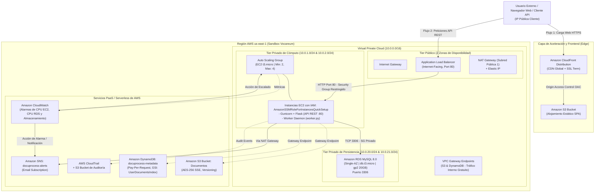

# DocuProcess Cloud — Plataforma SaaS de Procesamiento Asíncrono de Documentos

Infraestructura como Código (IaC) en Amazon Web Services (AWS) mediante HashiCorp Terraform v1.5+, optimizada y estrictamente adaptada para operar sin bloqueos sobre el entorno de laboratorio **AWS Academy Learner Lab / Sandbox (Vocareum)**.

---

## 1. Descripción General del Caso de Estudio

**DocuProcess Cloud** es una plataforma SaaS (*Software as a Service*) orientada al segmento empresarial (*B2B/Enterprise*), diseñada para la ingesta, almacenamiento, extracción de metadatos (OCR, conteo de páginas, hash criptográfico) y análisis asíncrono de documentos e imágenes de gran volumen.

### Requerimientos Funcionales y de Negocio
- **Portal Web de Usuario (Frontend Estático):** Aplicación de una sola página (*SPA - Single Page Application*) para registro, autenticación, subida de documentos y visualización en tiempo real del historial de procesamiento.
- **API REST de Gestión (Backend Compute):** Servicio web transaccional para autenticación, gestión de sesiones de usuario y endpoints para la ingesta y consulta de estado.
- **Módulo Worker de Procesamiento Asíncrono:** Proceso desacoplado en segundo plano (*Background Daemon*) que inspecciona las colas de trabajo, analiza los archivos persistidos en S3, extrae métricas y actualiza el almacén NoSQL.
- **Módulo de Notificaciones y Alertas:** Notificación automática hacia los clientes y administradores mediante Amazon SNS (correo electrónico) tras la finalización exitosa o falla en la ingesta.

---

## 2. Diagrama de Arquitectura de Referencia

La arquitectura implementa separación de preocupaciones (*Clean Architecture*) y aislamiento estricto de capas de red en el modelo OSI (Capas 2, 3, 4 y 7).

<p align="center">
  
</p>

<details>
<summary><b>Ver Definición en Código de Arquitectura (Mermaid.js)</b></summary>


</details>

---

## 3. Justificación Técnica: Base de Datos Relacional (RDS) vs. NoSQL (DynamoDB)

La arquitectura de DocuProcess Cloud emplea un enfoque políglota de persistencia (*Polyglot Persistence*), asignando cada modelo de datos al motor cuyas garantías matemáticas y de concurrencia satisfacen de forma óptima los requisitos del negocio:

| Dimensión Técnica | Amazon RDS (MySQL 8.0) | Amazon DynamoDB (NoSQL) |
| :--- | :--- | :--- |
| **Dominio y Caso de Uso** | **Cuentas de Usuario, Autenticación y Billing** | **Metadatos de Documentos, Historial y Logs de OCR** |
| **Modelo de Consistencia** | **ACID Estricto** (Atomicidad, Consistencia, Aislamiento serializable, Durabilidad). | **Eventual / Fuertemente Consistente** seleccionable por operación. |
| **Estructura del Esquema** | **Esquema Rígido y Normalizado (3FN):** Claves foráneas, tablas de roles, credenciales e integridad referencial. | **Sin Esquema (Schema-less / Flexible):** Metadatos variables por tipo de archivo (PDF, PNG, TIFF) con atributos heterogéneos. |
| **Complejidad de Consulta** | **Uniones Relacionales (SQL JOINs):** Comprobación de membresía, relaciones usuario-organización y transacciones financieras. | **Búsqueda por Clave Primaria (Key-Value):** Lecturas ultra-rápidas mediante `document_id` y consultas cronológicas indexadas. |
| **Complejidad Computacional** | Búsquedas indexadas por B-Tree con complejidad de tiempo: $$\mathcal{O}(\log N)$$ | Búsqueda por tabla Hash en la partición: $$\mathcal{O}(1)$$ |
| **Escalabilidad y Capacidad** | Escalado vertical de cómputo (con clase `db.t3.micro` en Sandbox); Single-AZ por directiva. | **Escalabilidad Horizontal Infinita:** Modelo `PAY_PER_REQUEST` (On-Demand) que absorbe ráfagas sin provisionar capacidad. |
| **Razón de Selección en DocuProcess** | Garantiza que no existan inconsistencias ni duplicidad en el registro de usuarios o asignación de privilegios. | Permite almacenar millones de registros de procesamiento con atributos dinámicos (OCR text, dimensiones, hash SHA-256) sin migraciones DDL. |

---

## 4. Requisitos Previos

Para ejecutar la infraestructura desde la consola o terminal del laboratorio:

1. **Credenciales Activas de AWS Academy Sandbox:**
   Copie el bloque de credenciales temporales desde la consola de Vocareum (`AWS Details -> AWS CLI`) y expórtelas en su terminal:
   ```bash
   export AWS_ACCESS_KEY_ID="ASI..."
   export AWS_SECRET_ACCESS_KEY="..."
   export AWS_SESSION_TOKEN="..."
   export AWS_DEFAULT_REGION="us-east-1"
   ```
2. **Terraform CLI v1.5+:**
   Compruebe la instalación local de Terraform:
   ```bash
   terraform -v
   ```
3. **AWS CLI v2:**
   Verifique la conectividad con la cuenta de laboratorio:
   ```bash
   aws sts get-caller-identity
   ```

---

## 5. Estructura Modular del Proyecto (Clean Architecture IaC)

La infraestructura como código está organizada modularmente siguiendo el principio de **Separación de Responsabilidades (Separation of Concerns)**, desacoplando cada dominio técnico en archivos temáticos sin introducir la sobrecarga ni el riesgo de reasignación de estados de los submódulos:

```
DocuProcess-Cloud-SaaS/
├── providers.tf         # Declaración de providers AWS y Random, data sources (AZs, AMI AL2023)
├── variables.tf         # Variables de entrada tipadas (región, CIDRs, credenciales, email)
├── locals.tf            # Nombres comunes, prefijos deterministas e identificador de rol SSM
├── network.tf           # VPC 10.0.0.0/16, 6 subredes, IGW, NAT GW, EIP, Tablas de Enrutamiento y VPC Endpoints
├── storage_cdn.tf       # Buckets S3 (Frontend, Docs, Logs), OAC y Distribución CloudFront (Reverse Proxy API)
├── database.tf          # Amazon RDS MySQL 8.0 (Single-AZ) y Amazon DynamoDB (docuprocess-metadata)
├── compute.tf           # Security Groups (ALB, EC2, RDS), ALB, Target Group, Launch Template y ASG
├── monitoring.tf        # Topic Amazon SNS, suscripción por correo, alarmas CloudWatch y políticas ASG
├── outputs.tf           # Endpoints públicos (ALB DNS, CloudFront CDN, RDS MySQL, S3, SNS ARN)
├── frontend/
│   └── index.html       # Single Page Application (SPA) interactiva con Tailwind CSS y polling
├── architecture.svg     # Diagrama vectorial SVG de alta resolución
└── README.md            # Documentación completa y manual de operación
```

---

## 6. Instrucciones Exactas de Despliegue Automatizado

El despliegue se encuentra 100% automatizado y orquestado mediante la plantilla modular de Terraform.

### Paso 1: Clonar / Navegar al Repositorio
```bash
cd DocuProcess-Cloud-SaaS
```

### Paso 2: Inicialización de Providers en Terraform
```bash
terraform init
```

### Paso 3: Validación Sintáctica y Estructural
```bash
terraform validate
```

### Paso 4: Generación y Revisión del Plan de Ejecución
```bash
terraform plan -out=tfplan.binary
```

### Paso 5: Aplicación de la Infraestructura
```bash
terraform apply "tfplan.binary"
```
*Tiempo estimado de aprovisionamiento:* ~8 a 12 minutos (principalmente debido a la creación de la instancia RDS MySQL y la distribución de CloudFront).

### Paso 6: Obtención de Endpoints y Verificación
Al finalizar la ejecución, Terraform imprimirá los *Outputs* operativos:
```bash
terraform output
```

Puede verificar el estado de salud de la API REST ejecutando una petición HTTP al ALB o HTTPS a CloudFront:
```bash
# Vía DNS directo del ALB:
curl -i $(terraform output -raw backend_alb_dns)/health

# Vía CDN global de CloudFront (HTTPS):
curl -i $(terraform output -raw frontend_cdn_domain)/health
```
Respuesta esperada:
```json
HTTP/1.1 200 OK
Content-Type: application/json

{"service":"DocuProcess-API","status":"healthy","timestamp":1772898720.0}
```

---

## 7. Demostración del Flujo Integral de la Plataforma

### 1. Acceso a la Interfaz Web (Frontend SPA)
Abra en cualquier navegador web la URL emitida por CloudFront:
```bash
echo $(terraform output -raw frontend_cdn_domain)
```
La interfaz Single Page Application (SPA) en Dark Glassmorphism permite registrar usuarios, cambiar de sesión activa (`admin`), subir archivos arrastrando con drag & drop y monitorear el procesamiento asíncrono con sondeo automático cada 3 segundos.

### 2. Registro de Usuario en Base de Datos Relacional (RDS MySQL)
```bash
curl -X POST $(terraform output -raw backend_alb_dns)/api/v1/auth/register \
  -H "Content-Type: application/json" \
  -d '{"username": "admin", "email": "azgomez2015@gmail.com"}'
```
*Respuesta:* `{"message": "User registered successfully", "user_id": 1, "username": "admin"}`.

### 3. Encolado de Documento para Procesamiento Asíncrono
```bash
curl -X POST $(terraform output -raw backend_alb_dns)/api/v1/documents \
  -H "Content-Type: application/json" \
  -d '{"user_id": "admin", "filename": "politica_seguridad_iso27001.pdf"}'
```
*Respuesta:* `{"document_id": "c7a8b9...", "status": "QUEUED"}`.

### 4. Ejecución del Worker y Verificación en DynamoDB
El demonio `worker.py` en ejecución dentro de las instancias EC2 detecta el estado `QUEUED`, realiza la extracción de metadatos (hash SHA-256, tamaño, páginas, timestamps), actualiza el registro en DynamoDB a `COMPLETED` y despacha el correo de confirmación mediante Amazon SNS hacia `azgomez2015@gmail.com`.

Consulte el estado actualizado:
```bash
curl $(terraform output -raw backend_alb_dns)/api/v1/documents/<document_id>
```

---

## 8. Guía de Solución de Problemas (Troubleshooting) en AWS Academy Sandbox

El entorno de AWS Academy Vocareum impone políticas de control de servicios (SCP) y restricciones de permisos altamente específicas. La siguiente tabla detalla las causas raíz y las resoluciones técnicas aplicadas en la arquitectura modular de IaC:

| Error Observado en Sandbox | Causa Raíz en Vocareum | Resolución Implementada en IaC Modular |
| :--- | :--- | :--- |
| `API: iam:CreateRole AccessDenied` o `iam:GetRole AccessDenied` | Los alumnos tienen denegadas todas las mutaciones y lecturas de IAM mediante SCP. | **Cero creación de IAM:** Se prescinde de `aws_iam_role` y `data "aws_iam_role"`. En [`compute.tf`](file:///home/robledo/DocuProcess-Cloud-SaaS/compute.tf) se referencia directamente por nombre el perfil preexistente: `name = "AmazonSSMRoleForInstancesQuickSetup"`. |
| `API: lambda:CreateFunction AccessDenied` | AWS Lambda está completamente bloqueado en el Sandbox debido a la falta de Trust Policy hacia `lambda.amazonaws.com`. | **Worker en EC2:** El procesamiento asíncrono se desacopló hacia un servicio daemon administrado por `systemd` dentro de las instancias del Auto Scaling Group en [`compute.tf`](file:///home/robledo/DocuProcess-Cloud-SaaS/compute.tf). |
| `Error: creating EC2 Launch Template: api error InvalidUserData.Malformed: User data is limited to 16384 bytes` | El script `user_data` sin comprimir que instala dependencias (Flask, Gunicorn, PyMySQL, Boto3) superaba 14 KB, excediendo la cuota estricta de EC2 Launch Template (16 KB). | **Compresión Gzip nativa:** En [`compute.tf`](file:///home/robledo/DocuProcess-Cloud-SaaS/compute.tf) se utilizó `user_data = base64gzip(<<-EOF ... EOF)`, reduciendo el tamaño a ~4.9 KB sin dependencias externas. |
| `User is not authorized to perform: ec2:RunInstances on resource: volume/* with an explicit deny in an identity-based policy` | Amazon Linux 2023 provisiona por defecto volúmenes EBS tipo `gp3`, pero Vocareum tiene una SCP que deniega explícitamente `gp3`. | **Fijación de volumen gp2:** En [`compute.tf`](file:///home/robledo/DocuProcess-Cloud-SaaS/compute.tf) se definió el bloque `block_device_mappings` para `/dev/xvda` forzando `volume_type = "gp2"` con 20 GB. |
| `Error: DBInstance MultiAZNotSupported` | Vocareum bloquea la creación de réplicas en standby para evitar sobrecostos. | La directiva `multi_az = false` está forzada en el recurso `aws_db_instance.mysql` en [`database.tf`](file:///home/robledo/DocuProcess-Cloud-SaaS/database.tf). |
| `NetworkError when attempting to fetch resource` (Frontend SPA) | Bloqueo por directiva de navegador de **Mixed Active Content**: La SPA servida por HTTPS en CloudFront intentaba consumir directamente el ALB por HTTP plano sin certificado SSL. | **CloudFront Reverse Proxy:** En [`storage_cdn.tf`](file:///home/robledo/DocuProcess-Cloud-SaaS/storage_cdn.tf) se agregó el ALB como origen secundario y se configuraron comportamientos de caché para `/api/*` y `/health` con redirección a HTTPS y soporte completo de verbos HTTP (`GET, HEAD, OPTIONS, PUT, POST, PATCH, DELETE`). |
| `404 Not Found` en la raíz del ALB (`/`) | El backend Flask solo tenía expuestas rutas bajo `/api/v1/...` y `/health`, dejando la raíz `/` sin manejar. | Se incorporó en [`compute.tf`](file:///home/robledo/DocuProcess-Cloud-SaaS/compute.tf) la ruta `@app.route("/")` retornando un payload descriptivo del servicio, estado y link a la SPA en CloudFront. |
| `(1054, "Unknown column 'role' in 'field list'")` en registro | Desincronización entre el esquema inicial SQL de MySQL y el modelo de datos de la aplicación. | Se incluyó la definición explícita de `role VARCHAR(30) DEFAULT 'user'` en el script DDL de inicialización en [`compute.tf`](file:///home/robledo/DocuProcess-Cloud-SaaS/compute.tf). |
| `Error deleting RDS: InvalidParameterValue (final snapshot)` | Al ejecutar `terraform destroy`, RDS intenta generar un snapshot final, lo cual falla por cuotas/permisos de IAM. | Se incluye `skip_final_snapshot = true` y `deletion_protection = false` en `aws_db_instance.mysql` en [`database.tf`](file:///home/robledo/DocuProcess-Cloud-SaaS/database.tf). |
| `Error: VcpuLimitExceeded` o `InstanceLimitExceeded` | Límite máximo de 9 instancias concurrentes en la cuenta de Sandbox. | El Auto Scaling Group está acotado estrictamente a `min_size = 2`, `desired_capacity = 2` y `max_size = 4` con instancias `t3.micro` en [`compute.tf`](file:///home/robledo/DocuProcess-Cloud-SaaS/compute.tf). |
| `Connection timed out on port 22` | El puerto SSH 22 está bloqueado por el Security Group por diseño de arquitectura de mínima exposición. | Se utiliza **AWS Systems Manager Session Manager** mediante el comando `aws ssm start-session --target <instance_id>`, garantizando acceso terminal cifrado sobre TLS sin exponer puertos. |

---

## 9. Destrucción de la Infraestructura

Al finalizar las pruebas o la sustentación, ejecute la liberación completa de recursos para evitar agotar los créditos de la cuenta de laboratorio:

```bash
terraform destroy -auto-approve
```

